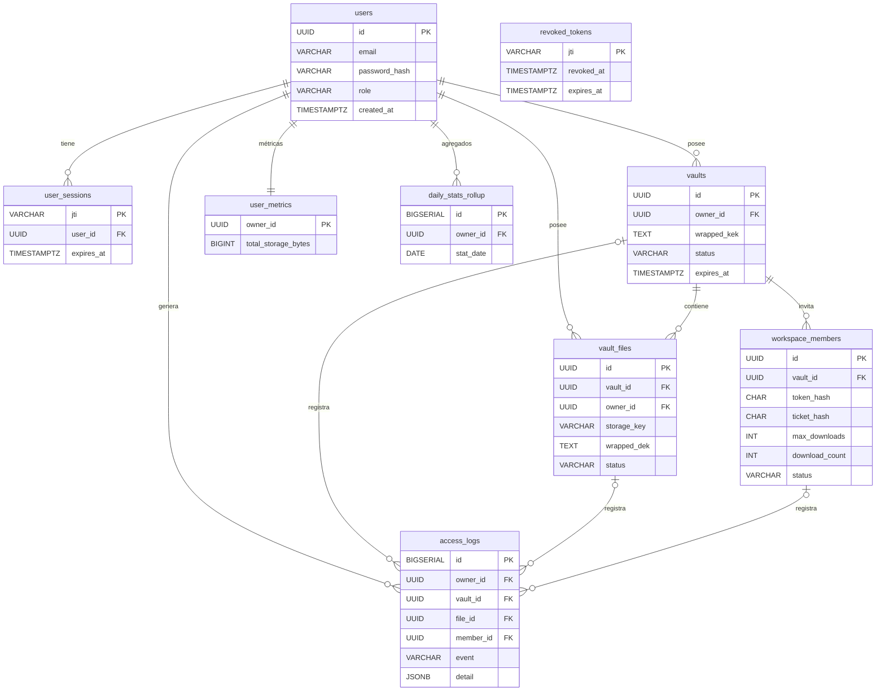

# SecDocs-DB (v2)

Repositorio oficial de la base de datos PostgreSQL 16 de **SecDocs**: bóveda digital segura con Envelope Encryption, autenticación fuera de banda por 2 canales, tickets de descarga atómicos y auditoría con retención legal LFPDPPP.

- **SecDocs-Backend** consume este esquema (consultas y `DATABASE_URL`).
- **SecDocs-Frontend** consume únicamente la API del Backend; nunca accede a la base de datos.
- Los archivos de la versión 1 están en [`legacy/`](legacy/).

## Diagrama Entidad-Relación



`revoked_tokens` no tiene FK: es una lista negra de `jti` de alta velocidad.

## Arquitectura de Seguridad en Base de Datos

La arquitectura criptográfica es **Envelope Encryption en servidor**: `MASTER_ENCRYPTION_KEY (MEK)` → `KEK por bóveda` → `DEK por archivo`, con `AES-256-GCM`, combinada con **Crypto-Shredding** a nivel de esquema.

### Cero secretos en texto plano
| Dato | Protección |
|---|---|
| `users.password_hash`, `workspace_members.password_hash` | `bcrypt` costo 12 |
| `workspace_members.token_hash`, `ticket_hash` | `SHA-256` (`CHAR(64)`) |
| `vaults.wrapped_kek`, `vault_files.wrapped_dek` | `AES-256-GCM`, formato `iv:authTag:ciphertext` en base64 |

La KEK se cifra con la MEK (que vive fuera de la base de datos) y la DEK con la KEK de su bóveda.

### Crypto-Shredding por invariantes SQL
- `vaults`: `CHECK (status <> 'PURGED' OR wrapped_kek IS NULL)`
- `vault_files`: `CHECK (status = 'ACTIVE' OR wrapped_dek IS NULL)`

PostgreSQL rechaza a nivel motor que una bóveda o archivo pase a `PURGED` sin haber destruido (`NULL`) su llave envuelta. Sin la llave, el binario `.enc` en R2 es irrecuperable. Ver `scripts/demo_crypto_shredding.sql`.

### Consumo atómico de tickets y control de descargas
- `wm_ticket_idx` es un índice único parcial (`WHERE ticket_hash IS NOT NULL`): no pueden coexistir dos miembros con el mismo ticket vigente.
- Un único `UPDATE ... SET ticket_hash = NULL, download_count = download_count + 1 WHERE ticket_hash = $1 ... RETURNING` consume el ticket: ante peticiones concurrentes solo una obtiene fila.
- `CHECK (download_count <= max_downloads)` impide superar el límite aunque falle la lógica de aplicación.

### Cumplimiento LFPDPPP (retención de 6 meses)
- `access_logs` (con IP y User-Agent) es la bitácora auditable; se purga a los 6 meses (`scripts/maintenance_lfpdppp.sql`).
- `daily_stats_rollup` guarda solo agregados anónimos, con conservación indefinida. Se actualiza con upsert atómico:

```sql
INSERT INTO daily_stats_rollup (owner_id, stat_date, total_downloads)
VALUES ($1, CURRENT_DATE, 1)
ON CONFLICT (owner_id, stat_date)
DO UPDATE SET total_downloads = daily_stats_rollup.total_downloads + 1;
```

## Diccionario de Datos

### users
| Columna | Tipo | Notas |
|---|---|---|
| id | UUID PK | `gen_random_uuid()` |
| email | VARCHAR(255) | Único por `lower(email)` (`users_email_lower_idx`) |
| password_hash | VARCHAR(255) | bcrypt costo 12 |
| role | VARCHAR(20) | `user` \| `admin` |
| created_at | TIMESTAMPTZ | |

### user_sessions
| Columna | Tipo | Notas |
|---|---|---|
| jti | VARCHAR(128) PK | ID del JWT |
| user_id | UUID FK → users | CASCADE |
| ip, user_agent | VARCHAR(64), VARCHAR(300) | Opcionales |
| created_at, expires_at | TIMESTAMPTZ | |

### revoked_tokens
| Columna | Tipo | Notas |
|---|---|---|
| jti | VARCHAR(128) PK | |
| revoked_at, expires_at | TIMESTAMPTZ | Índice por expiración para limpieza |

### vaults
| Columna | Tipo | Notas |
|---|---|---|
| id | UUID PK | |
| owner_id | UUID FK → users | CASCADE |
| name | VARCHAR(150) | |
| wrapped_kek | TEXT | `NULL` si fue purgada |
| status | VARCHAR(15) | `ACTIVE`, `LOCKED`, `EXPIRED`, `PURGED` |
| expires_at, purged_at, created_at | TIMESTAMPTZ | |

### vault_files
| Columna | Tipo | Notas |
|---|---|---|
| id | UUID PK | |
| vault_id | UUID FK → vaults | CASCADE |
| owner_id | UUID FK → users | CASCADE |
| original_filename | VARCHAR(255) | |
| mime_type | VARCHAR(120) | Detectado por magic bytes |
| size_bytes | BIGINT | `>= 0` |
| storage_key | VARCHAR(80) UNIQUE | `<uuid>.enc` en Cloudflare R2 |
| wrapped_dek | TEXT | `NULL` = crypto-shredding |
| iv, auth_tag | VARCHAR(64) | Base64, AES-256-GCM (12 y 16 bytes) |
| status | VARCHAR(10) | `ACTIVE` \| `PURGED` |
| purged_at, created_at | TIMESTAMPTZ | |

### workspace_members
| Columna | Tipo | Notas |
|---|---|---|
| id | UUID PK | |
| vault_id | UUID FK → vaults | CASCADE |
| recipient_email, recipient_label | VARCHAR(255), VARCHAR(120) | |
| token_hash | CHAR(64) UNIQUE | SHA-256 del token de invitación |
| password_hash | VARCHAR(255) | bcrypt costo 12 (Canal 2) |
| max_downloads / download_count | INT | 1–10 / `>= 0` y `<= max_downloads` |
| failed_attempts, locked_until | INT, TIMESTAMPTZ | Bloqueo temporal |
| status | VARCHAR(20) | `PENDING`, `ACCEPTED`, `TEMP_LOCKED`, `REVOKED`, `EXPIRED` |
| ticket_hash, ticket_expires_at | CHAR(64), TIMESTAMPTZ | Ticket de un solo uso (TTL 60 s) |
| expires_at, last_access_at, created_at | TIMESTAMPTZ | |

### access_logs
| Columna | Tipo | Notas |
|---|---|---|
| id | BIGSERIAL PK | |
| owner_id | UUID FK → users | CASCADE |
| vault_id, file_id, member_id | UUID FK | `ON DELETE SET NULL` |
| event | VARCHAR(50) | |
| ip, user_agent | VARCHAR(64), VARCHAR(300) | |
| detail | JSONB | Default `{}` |
| created_at | TIMESTAMPTZ | Retención 6 meses |

### user_metrics
| Columna | Tipo | Notas |
|---|---|---|
| owner_id | UUID PK FK → users | CASCADE |
| total_storage_bytes | BIGINT | |
| total_files_active, total_vaults_active | INT | |
| updated_at | TIMESTAMPTZ | |

### daily_stats_rollup
| Columna | Tipo | Notas |
|---|---|---|
| id | BIGSERIAL PK | |
| owner_id | UUID FK → users | CASCADE |
| stat_date | DATE | `UNIQUE (owner_id, stat_date)` |
| total_downloads, total_failed_attempts, unique_visitors | INT | Agregados anónimos |

## Guía rápida

```bash
cp .env.example .env
docker compose up -d          # crea el volumen y aplica migrations/001_init.sql

# Aplicar manualmente (idempotente)
docker compose exec -T db psql -U secdocs -d secdocs < migrations/001_init.sql

# Verificar el esquema
docker compose exec -T db psql -U secdocs -d secdocs < scripts/verify_schema.sql

# Demo de crypto-shredding (termina en ROLLBACK)
docker compose exec -T db psql -U secdocs -d secdocs < scripts/demo_crypto_shredding.sql

# Mantenimiento LFPDPPP
docker compose exec -T db psql -U secdocs -d secdocs < scripts/maintenance_lfpdppp.sql
```

Para reiniciar desde cero: `docker compose down -v`.
